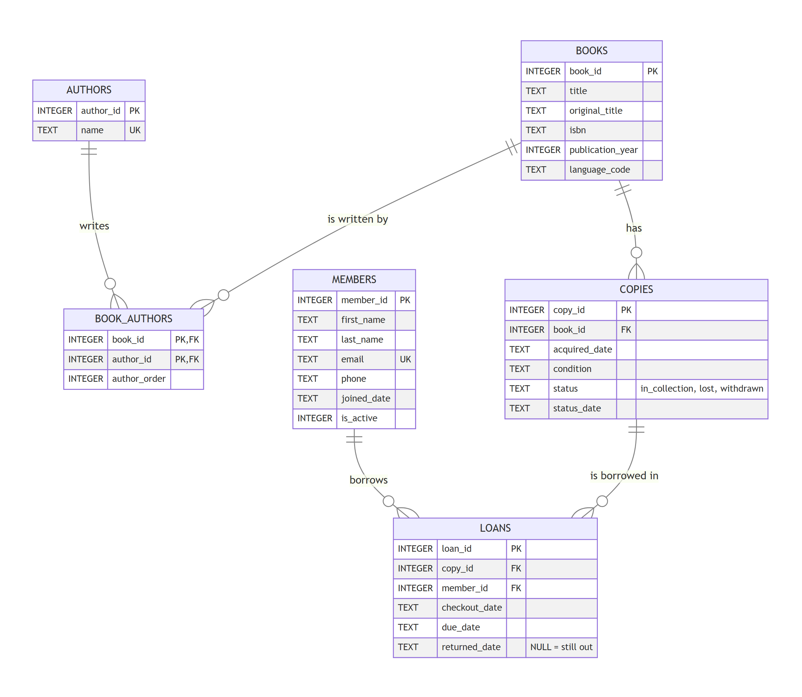
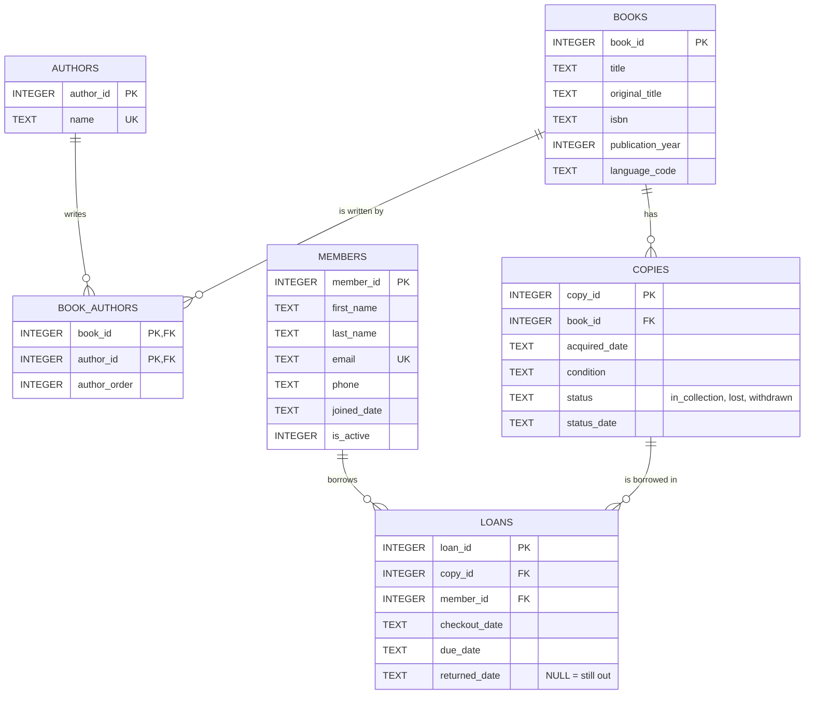

# Library Database – ERD and Summary

Mermaid source

## Summary

### What each table represents

- **books** – a title the library carries, such as *The Hobbit*. It holds the facts that are true of every copy: title, ISBN, publication year, language. The 30 rows come straight from Goodbooks-10k, keeping the same `book_id`.
- **authors** – a person credited on a book. It exists so a name is stored once, not retyped for every book, which lets me ask "what books do we have by J.K. Rowling?"
- **book_authors** – a link table that pairs a book with each of its authors and records the order they're listed in. It exists only to connect books and authors.
- **copies** – a physical book on the shelf. The library might own three copies of *The Hunger Games*, and members borrow a specific copy, not a title. It records when the copy was acquired, its condition, and whether it is in the collection, lost, or withdrawn.
- **members** – a person with a library card: name, contact info, join date, and whether the card is active.
- **loans** – one borrowing of one copy by one member, with checkout, due, and return dates. Loans are never deleted, so this table is the library's full borrowing history.

### Relationships

**One-to-many** relationships are tracked with a foreign key on the "many" side:

- One book has many copies → `copies.book_id`
- One member has many loans → `loans.member_id`
- One copy is borrowed many times over its life → `loans.copy_id`

**Many-to-many:** a book can have several authors (the CSV lists "J.K. Rowling, Mary GrandPré" in one field), and an author writes many books. A single foreign key can't hold that, so `book_authors` breaks it into two one-to-many links. Each row holds one `book_id` and one `author_id`, and the pair is the primary key, so the same author can't be attached to a book twice.

The database also enforces some rules itself. Foreign keys stop a loan from pointing to a member who doesn't exist. A check makes the due date come after the checkout date. A unique index means a copy can be on only one open loan at a time.

### A design decision: status is calculated, not stored

My first idea was a `status` column on each copy that says "available," "on loan," or "overdue." The problem is that "overdue" changes every midnight without anyone touching the data, and "on loan" has to be updated every time a book goes out or comes back. If someone forgets, the database contradicts itself.

Instead, `copies.status` only stores things a person has to decide: *in_collection*, *lost*, or *withdrawn*. A view called `copy_status` works out the rest from the loans table. A copy with an open loan (no `returned_date`) is *on loan*, and if its due date has passed it is *overdue*. Because it is calculated every time, it can't go out of date.

Lost books work the same way. The copy is marked *lost* with a date, but it is never deleted, and its last loan stays open. The library can still see that Thomas Jefferson had *Twilight* when it disappeared.

Current totals: 54 copies available, 3 on loan, 2 overdue, 1 lost.

### What Claude got wrong, or I changed

- **I changed the members.** Claude made up generic names. I had it replace them with former US Presidents, from George Washington to Calvin Coolidge (who has never borrowed anything).
- **The data needed cleanup Claude had to catch.** The `isbn13` column in books.csv is in scientific notation (`9.78043902348e+12`), which has lost digits. We used the ISBN-10 column instead and restored the leading zeros it had dropped. One author name, "Robert Jackson," had a run of extra spaces in the middle that had to be collapsed.
- **Still not right:** books.csv lists illustrators and translators as "authors." Mary GrandPré illustrated Harry Potter, and Celâl Üster translated *1984*. The CSV doesn't say who did what, so the database treats everyone as an author. A better design would add a `role` column to `book_authors`.
- **The first ERD image came out tiny**, a small diagram in a mostly blank picture. It had to be re-rendered at full size.
